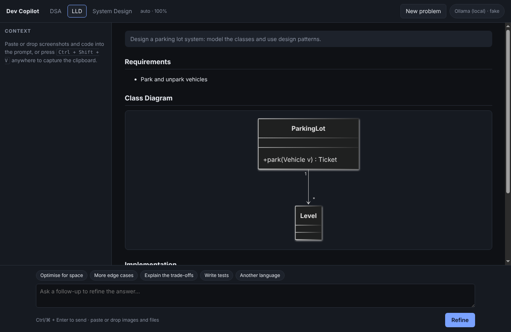
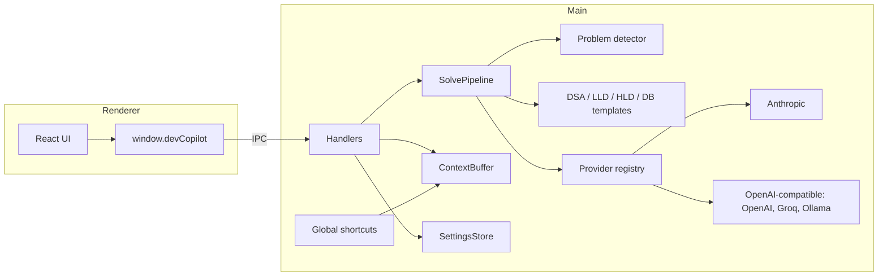

# Dev Copilot (desktop)

An Electron scratchpad that turns coding problems and design discussions into structured technical breakdowns. Paste or capture a problem, and it detects whether it is a **DSA** problem, a **Low-Level Design**, a **System Design** or a **Database Design**, then answers with the matching template. Follow-ups refine the same answer.



## Run it

```bash
npm install
npm run dev        # Electron with hot reload
npm test           # unit tests (vitest)
npm run build      # typecheck + production build into out/
npm run package    # installers via electron-builder
```

Open **Settings** (the provider pill, top right), pick a provider, paste an API key (or point Ollama at your local server) and press **Test connection**.

## What iteration 1 includes

| Area | Where |
| --- | --- |
| Electron shell, secure window (context isolation, sandbox, CSP) | `src/main/index.ts` |
| Typed preload bridge (`window.devCopilot`) and IPC contract | `src/preload/index.ts`, `src/shared/ipc.ts` |
| `LLMProvider` interface | `src/main/providers/LLMProvider.ts` |
| Claude via the official Anthropic SDK | `src/main/providers/anthropic.ts` |
| OpenAI, Groq and Ollama via one OpenAI-compatible client | `src/main/providers/openaiCompatible.ts` |
| Provider registry (add a vendor here) | `src/main/providers/registry.ts` |
| Problem-type detection: keyword heuristics, model fallback when unsure | `src/main/pipeline/detector.ts` |
| DSA / LLD / System Design / Database Design output templates | `src/main/pipeline/templates/` |
| Prompt assembly and the solve pipeline with follow-up history | `src/main/pipeline/promptBuilder.ts`, `pipeline.ts` |
| Settings with API keys encrypted by the OS keychain (`safeStorage`) | `src/main/settings/` |
| Context buffer: typed text, pasted/dropped images and files, clipboard | `src/main/inputs/ContextBuffer.ts` |
| Global shortcuts | `src/main/inputs/shortcuts.ts` |
| Translucent overlay window | `src/main/window.ts` |
| In-window key map and shortcut recorder | `src/renderer/src/keyboard.ts`, `components/ShortcutInput.tsx` |
| React UI: streaming Markdown, Mermaid diagrams, copyable code, follow-up chips | `src/renderer/src/` |

### The overlay

The window is a frameless, transparent overlay that stays above other windows, so you can read the code behind it. Background opacity is adjustable (`Ctrl/⌘ + [` and `]`, or in Settings) while text stays fully opaque. On macOS the background also gets a native blur.


### Keyboard first

Everything works without the mouse. Global shortcuts work while another app is focused; all of them can be re-recorded in Settings (focus a field and press the new keys).

| Global shortcut | Action |
| --- | --- |
| `Ctrl/⌘ + Shift + K` | Show the overlay with the prompt focused, to type a custom message |
| `Ctrl/⌘ + Shift + V` | Add the clipboard (image or text) to the context buffer |
| `Ctrl/⌘ + Shift + Enter` | Solve the captured context without typing |
| `Ctrl/⌘ + Shift + Space` | Show or hide the overlay |
| `Ctrl/⌘ + Shift + Up / Down` | Scroll the answer without focusing the overlay |
| `Ctrl/⌘ + Alt + Arrow keys` | Move the overlay |

| In the overlay | Action |
| --- | --- |
| `Enter` / `Shift + Enter` | Send / new line |
| `Esc` | Stop the answer, close a dialog, or hide the overlay |
| `Alt + 1…5` | Quick follow-ups for the current type (DSA: optimise space, edge cases, tests…; LLD: thread safety, new feature, patterns…; System Design: scale 10x, deep dive, schema & sharding, sequence diagram, interviewer follow-ups; Database: sample data, query tuning, NoSQL version…) |
| `Ctrl/⌘ + 1…4` | Switch DSA / LLD / System Design / Database (re-runs the answer) |
| `Ctrl/⌘ + N` | New problem |
| `Ctrl/⌘ + Shift + C` | Copy the solution code (every block of the Code / Implementation / Tables section) |
| `Ctrl/⌘ + J` / `Ctrl/⌘ + Shift + J` | Jump to the next / previous section |
| `Ctrl/⌘ + D` | Open the diagram in view full-size: `+` / `-` zoom, `0` fit, arrows scroll, `Tab` next diagram, `Ctrl/⌘ + S` save SVG |
| `Ctrl/⌘ + S` | Save the conversation as Markdown |
| `Ctrl/⌘ + I` | Interview step mode: clarifying questions first, then one section per `Alt + N` |
| `PageUp / PageDown`, `Alt + Up / Down` | Scroll the answer |
| `Ctrl/⌘ + Shift + Backspace` / `Ctrl/⌘ + Shift + X` | Remove newest context item / clear context |
| `Ctrl/⌘ + ,` | Settings (Tab between fields, `Ctrl/⌘ + Enter` saves, `Esc` cancels) |
| `Ctrl/⌘ + /` or `F1` | Shortcut list |

Code is written in Java by default; change it in Settings.

## Architecture



A request flows: context buffer + prompt → detection (heuristic, then the model only if unsure, or a type the user picked) → system prompt from the template → streamed answer over IPC. The conversation history stays in the main process, so a follow-up such as "optimise for space" reuses the detected type and prior answer.

## Extension points for later iterations

- **Screen region capture**: implement `ScreenCaptureService` (`src/main/inputs/InputSource.ts`) and pass it to `registerShortcuts`; the `captureScreen` shortcut is already in settings and is skipped until a service exists.
- **Whisper transcription**: implement `TranscriptionService` against a local whisper.cpp server and pass a `toggleRecording` handler; transcripts go into the buffer with source `audio`, which prompts already label as a voice transcript.
- **New provider**: add an id to `ProviderId` and one entry to the registry.
- **New problem type**: add a template and signals in `detector.ts`.

## Notes

- Claude models default to `claude-opus-5-5`. Current Claude models reject `temperature`, so the Anthropic provider uses `effort` instead and opts into server-side refusal fallbacks.
- OpenAI defaults to `gpt-5` and uses `max_completion_tokens`; model ids are free text in settings, with suggestions.
- If the OS keychain is unavailable (some Linux setups), keys fall back to base64 on disk.
