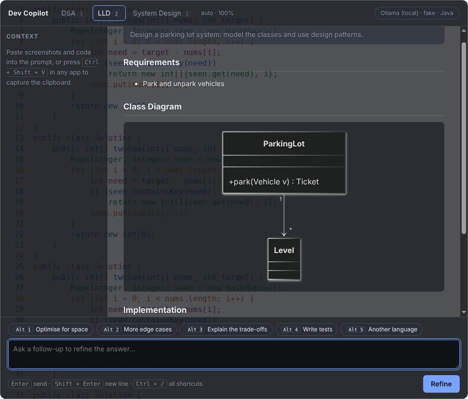
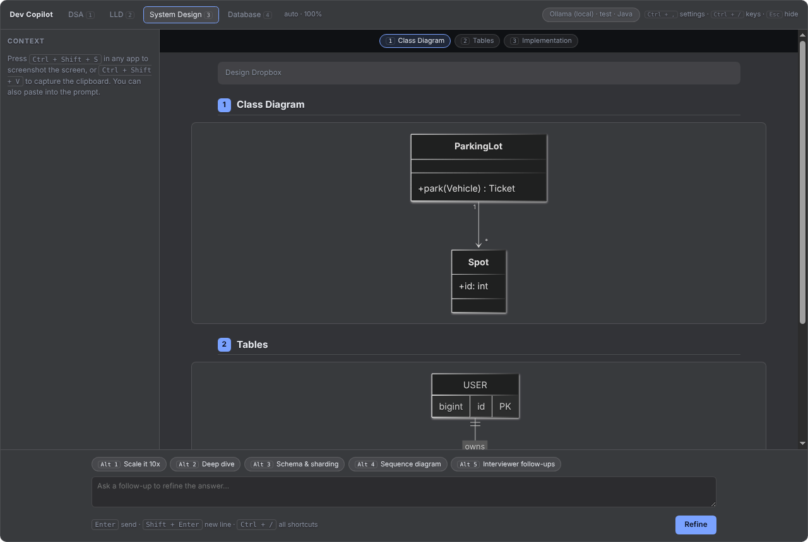
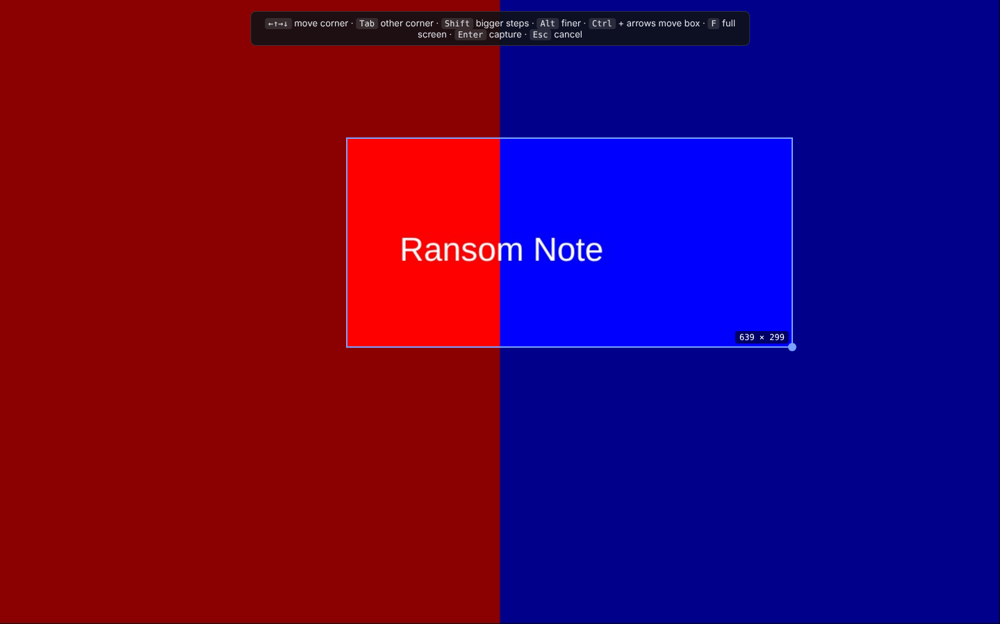
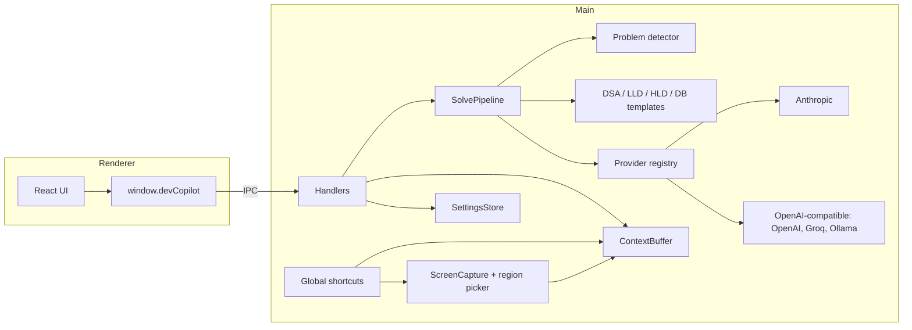

# Dev Copilot (desktop)

An Electron scratchpad that turns coding problems and design discussions into structured technical breakdowns. Paste or capture a problem, and it detects whether it is a **DSA** problem, a **Low-Level Design**, a **System Design** or a **Database Design**, then answers with the matching template. Follow-ups refine the same answer.


## Install (no npm needed)

Ready-built installers are in `releases/` of the project folder:

- **Windows:** run `Dev Copilot Setup 0.1.0.exe`. It installs for your user, adds Desktop and Start menu shortcuts, and opens the app.
- **Linux:** double-click `Dev Copilot-0.1.0.AppImage` (if your file manager asks, allow it to run as a program, or `chmod +x` it once).
- **macOS:** a `.dmg` has to be built on a Mac: `npm install && npm run dist:mac`, then open `dist/Dev Copilot-0.1.0-arm64.dmg`. The build is unsigned, so the first time right-click the app and choose **Open**.

Launching the app again while it runs brings the existing overlay to the front.

## Run from source

```bash
npm install
npm run dev        # Electron with hot reload
npm test           # unit tests (vitest)
npm run build      # typecheck + production build into out/
npm run package    # installers via electron-builder (or dist:win / dist:linux / dist:mac)
```

By default the app answers through **Claude (your subscription)**: it runs your local [Claude Code](https://claude.ai/code) CLI with your Claude account, so no API key is needed. Install it once with `curl -fsSL https://claude.ai/install.sh | bash`, run `claude` in Terminal and sign in. Usage counts against your Claude plan's limits. The app never sees your credentials.

To use an API instead, open **Settings** (the provider pill, top right), pick a provider, paste an API key (or point Ollama at your local server) and press **Test connection**.

## What iteration 1 includes

| Area | Where |
| --- | --- |
| Electron shell, secure window (context isolation, sandbox, CSP) | `src/main/index.ts` |
| Typed preload bridge (`window.devCopilot`) and IPC contract | `src/preload/index.ts`, `src/shared/ipc.ts` |
| `LLMProvider` interface | `src/main/providers/LLMProvider.ts` |
| Claude via the official Anthropic SDK | `src/main/providers/anthropic.ts` |
| OpenAI, Groq and Ollama via one OpenAI-compatible client | `src/main/providers/openaiCompatible.ts` |
| Claude through the local Claude Code CLI and your subscription (no key) | `src/main/providers/claudeCode.ts` |
| Provider registry (add a vendor here) | `src/main/providers/registry.ts` |
| Problem-type detection: keyword heuristics, model fallback when unsure | `src/main/pipeline/detector.ts` |
| DSA / LLD / System Design / Database Design output templates | `src/main/pipeline/templates/` |
| Prompt assembly and the solve pipeline with follow-up history | `src/main/pipeline/promptBuilder.ts`, `pipeline.ts` |
| Settings with API keys encrypted by the OS keychain (`safeStorage`) | `src/main/settings/` |
| Context buffer: typed text, pasted/dropped images and files, clipboard, screen captures | `src/main/inputs/ContextBuffer.ts` |
| Screen region capture and the keyboard region picker | `src/main/inputs/ScreenCapture.ts`, `src/renderer/src/capture/` |
| Global shortcuts | `src/main/inputs/shortcuts.ts` |
| Translucent overlay window | `src/main/window.ts` |
| In-window key map and shortcut recorder | `src/renderer/src/keyboard.ts`, `components/ShortcutInput.tsx` |
| React UI: streaming Markdown, Mermaid diagrams, copyable code, follow-up chips | `src/renderer/src/` |

### The overlay

The window is a frameless, transparent overlay that stays above other windows, so you can read the code behind it. Background opacity is adjustable (`Ctrl/⌘ + [` and `]`, or in Settings) while text stays fully opaque. On macOS the background also gets a native blur.



### Keyboard first

Everything works without the mouse. Global shortcuts work while another app is focused; all of them can be re-recorded in Settings (focus a field and press the new keys).

| Global shortcut | Action |
| --- | --- |
| `Ctrl/⌘ + Shift + K` | Show the overlay with the prompt focused, to type a custom message |
| `Ctrl/⌘ + Shift + S` | Screenshot the whole screen into the context buffer, instantly (see below) |
| `Ctrl/⌘ + Alt + S` | Screenshot a region you pick first |
| `Ctrl/⌘ + Shift + V` | Add the clipboard (image or text) to the context buffer |
| `Ctrl/⌘ + Shift + Enter` | Solve the captured context without typing |
| `Ctrl/⌘ + Shift + Space` | Show or hide the overlay |
| `Ctrl/⌘ + M` | Minimize the overlay; press again (from any app) to bring it back |
| `Ctrl/⌘ + Shift + M` | Mouse click-through on / off. On by default: clicks, scrolling and hovering go to the app behind the overlay, so you can draw or browse under it |
| `Ctrl/⌘ + Shift + Up / Down` | Scroll the answer without focusing the overlay |
| `Ctrl/⌘ + Alt + Arrow keys` | Move the overlay (inside the overlay, `Ctrl/⌘ + Arrow keys` alone also works, except in the prompt box) |

| In the overlay | Action |
| --- | --- |
| `Enter` / `Shift + Enter` | Send / new line |
| `Esc` | Stop the answer, close a dialog, or hide the overlay |
| `Tab` | Move between the prompt box and the answer |
| `1…9` / `0` | Jump to that numbered section of the answer / back to the question. Sending a prompt moves focus to the answer so these work right away; `Tab` or `Ctrl/⌘ + L` goes back to the prompt box, where digits type normally |
| `Alt + 1…5` | Quick follow-ups for the current type (DSA: optimise space, edge cases, tests…; LLD: thread safety, new feature, patterns…; System Design: scale 10x, deep dive, schema & sharding, sequence diagram, interviewer follow-ups; Database: sample data, query tuning, NoSQL version…) |
| `Ctrl/⌘ + 1…4` | Switch DSA / LLD / System Design / Database (re-runs the answer) |
| `Ctrl/⌘ + N` | New problem |
| `Ctrl/⌘ + Shift + C` | Copy the solution code (every block of the Code / Implementation / Tables section) |
| `Ctrl/⌘ + J` / `Ctrl/⌘ + Shift + J` | Jump to the next / previous section |
| `Ctrl/⌘ + D` | Open the diagram in view full-size: `+` / `-` zoom, `0` fit, arrows scroll, `Tab` next diagram, `Ctrl/⌘ + S` save SVG |
| `Ctrl/⌘ + S` | Save the conversation as Markdown |
| `Ctrl/⌘ + I` | Interview step mode: clarifying questions first, then one section per `Alt + N` |
| `PageUp / PageDown`, `Alt + Up / Down` | Scroll the answer |
| `Ctrl/⌘ + Shift + Backspace` / `Ctrl/⌘ + Shift + X` | Remove newest context item / clear context |
| `Ctrl/⌘ + [` / `Ctrl/⌘ + ]` | Less / more opaque background |
| `Ctrl/⌘ + -` / `Ctrl/⌘ + =` / `Ctrl/⌘ + 0` | Smaller / bigger / default text size |
| `Ctrl/⌘ + ,` | Settings (Tab between fields, `Ctrl/⌘ + Enter` saves, `Esc` cancels) |
| `Ctrl/⌘ + /` or `F1` | Shortcut list |

Code is written in Java by default; change it in Settings.

Answers are split into numbered sections, listed in a bar pinned to the top of the answer. System Design answers are built bottom-up: requirements and estimates, then **Phase 1** (the simplest design that works, with a small diagram), **Phase 2** (what breaks and the scaled design, new parts highlighted) and **Phase 3** (caching, queues and replication), followed by the data model, deep dives and trade-offs. Wide diagrams no longer shrink below 80% of their natural size; they scroll sideways instead, and `Ctrl/⌘ + D` opens any diagram full-size.



### Screen capture

For pages where copying is blocked, `Ctrl/⌘ + Shift + S` screenshots the whole screen under the mouse pointer straight into the context buffer, with nothing to select. The overlay fades out for a split second so it isn't in the shot.

To capture only part of the screen, `Ctrl/⌘ + Alt + S` freezes the screen and opens a region picker:

| In the picker | Action |
| --- | --- |
| Arrow keys | Move the highlighted corner (starts at top-left) |
| `Tab` | Switch to the other corner |
| `Shift` / `Alt` + arrows | Bigger / finer steps |
| `Ctrl/⌘` + arrows | Move the whole box |
| `F` | Select the full screen again (the default) |
| `Enter` | Capture; `Esc` cancels |

In the picker, dragging with the mouse also works. Either way, the screenshot joins the context buffer and the overlay comes forward with the prompt focused, so `Enter` solves it. Take several shots for a long statement (scroll, capture again); they are sent in order as one problem. A shot taken after an answer is attached to the next follow-up only. Images go to every provider; pick a vision model for OpenAI, Groq or Ollama.

On macOS the first capture asks for **Screen Recording** permission. If it is off, the app opens System Settings > Privacy & Security > Screen & System Audio Recording; turn Dev Copilot on, then quit and reopen it. Because local builds are not signed with a developer certificate, macOS may ask again after you install a new build.



## Architecture



A request flows: context buffer + prompt → detection (heuristic, then the model only if unsure, or a type the user picked) → system prompt from the template → streamed answer over IPC. The conversation history stays in the main process, so a follow-up such as "optimise for space" reuses the detected type and prior answer.

## Extension points for later iterations

- **Whisper transcription**: implement `TranscriptionService` against a local whisper.cpp server and pass a `toggleRecording` handler; transcripts go into the buffer with source `audio`, which prompts already label as a voice transcript.
- **New provider**: add an id to `ProviderId` and one entry to the registry.
- **New problem type**: add a template and signals in `detector.ts`.

## Notes

- Claude models default to `claude-opus-5-5`. Current Claude models reject `temperature`, so the Anthropic provider uses `effort` instead and opts into server-side refusal fallbacks.
- OpenAI defaults to `gpt-5` and uses `max_completion_tokens`; model ids are free text in settings, with suggestions.
- If the OS keychain is unavailable (some Linux setups), keys fall back to base64 on disk.
